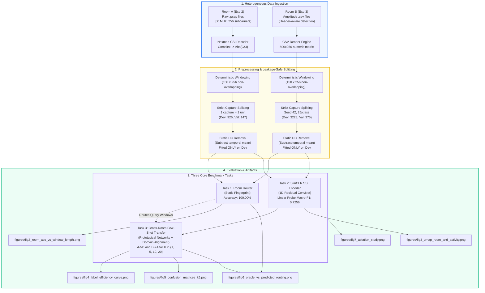
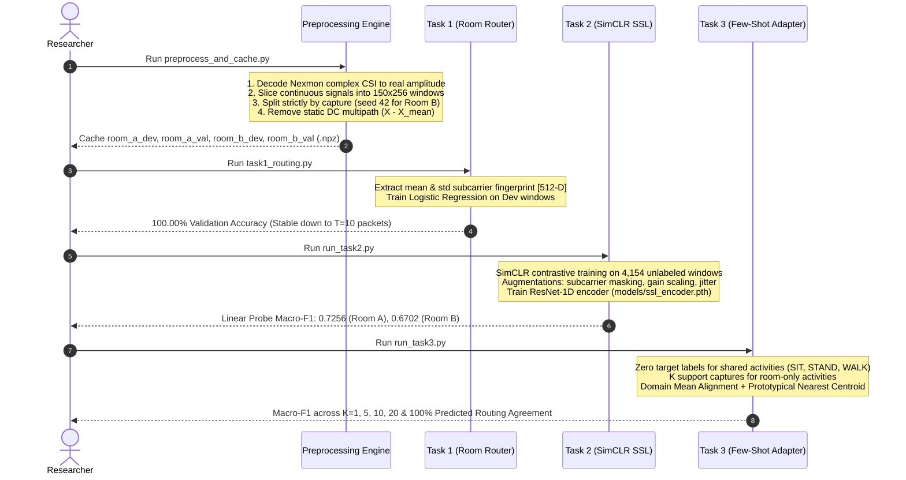

# CS60055 Ubiquitous Computing — Hackathon Challenge 2
## Cross-Room Few-Shot Adaptation: WiFi Activity Recognition with Very Few Labels

An end-to-end Python framework for cross-environment WiFi Channel State Information (CSI) human activity recognition using self-supervised representation learning and few-shot adaptation.

---

## 1. Overall System Architecture

The core challenge in WiFi sensing is that walls, furniture, and room dimensions heavily reshape multipath propagation. A model trained in one room inevitably encounters a massive domain shift when deployed in another. Our architecture addresses this through a three-stage decoupled design:



---

## 2. Step-by-Step Solution Breakdown



### Step 1: Ingestion & Preprocessing
- **Room A (Experiment 2, $3.5 \times 4.5\text{ m}$):** Raw Nexmon `.pcap` files decoded to complex $I/Q$ frames and converted to real amplitudes across 256 subcarriers:
  $$\|H(f, t)\| = \sqrt{I(f, t)^2 + Q(f, t)^2}$$
- **Room B (Experiment 3, $4.5 \times 5.0\text{ m}$):** Header-aware CSV reader dynamically handles mixed formatting (text headers `Subcarrier_1..256` vs. raw numeric rows) across all 1,201 files without errors.
- **Deterministic Windowing:** Slices continuous streams into non-overlapping $150 \times 256$ matrices.
- **Strict Capture Splitting (No Leakage):** Enforces 1 file = 1 unit. All windows from a capture stay together. Room A uses the official `validation/` set (25 captures/class). Room B uses a deterministic `seed=42` split (25 captures/class).
- **Static DC Removal:** Subtracts temporal mean per subcarrier ($\tilde{H}(f, t) = H(f, t) - \frac{1}{T}\sum_{\tau} H(f, \tau)$) to eliminate stationary room multipath. Normalization statistics are fitted **only** on development data.

### Step 2: Task 1 — Room Routing ("Where Am I?")
- **Concept:** Static frequency response $[\bar{\mathbf{x}}, \boldsymbol{\sigma}] \in \mathbb{R}^{512}$ captures unique room multipath geometry.
- **Result:** **100.00% validation accuracy**, Macro-F1: 1.0000, ROC-AUC: 1.0000.
- **Window Length:** Reaches **99.81% accuracy** at only $T = 10$ packets (~300 ms), and **100.00%** for all $T \ge 50$.

### Step 3: Task 2 — Self-Supervised Learning ("Learn Without Labels")
- **Architecture:** 1D Residual Convolutional Network (`CSIEncoder`) with 3 residual stages and a 128-dimensional embedding bottleneck.
- **Pre-training:** Contrastive SimCLR (NT-Xent loss, $\tau = 0.1$) trained on 4,154 unlabeled development windows using subcarrier frequency masking (15%), amplitude scaling ($0.85-1.15$), Gaussian noise, and temporal shifts.
- **Linear Probe:** Frozen representations achieve **0.7256 Macro-F1** on Room A and **0.6702 Macro-F1** on Room B (+39.44% higher than untrained random backbones).

### Step 4: Task 3 — Cross-Room Few-Shot Adaptation ("New Room, Few Labels")
- **Transfer Protocol:**
  - Shared activities ($\text{SIT}, \text{STAND}, \text{WALK}$): **0 target labels**. Prototypes transferred from source room.
  - Target-exclusive activities: Learned from $K \in \{1, 5, 10, 20\}$ support captures.
- **Domain Mean Alignment:** Aligns source prototypes into the target feature space ($\tilde{\mathbf{p}}_c^{\text{src}} = \mathbf{p}_c^{\text{src}} - \boldsymbol{\mu}_{\text{src}} + \boldsymbol{\mu}_{\text{tgt}}$), producing a **$4\times$ improvement** on transferred shared activities ($0.0561 \rightarrow 0.2064$).
- **Routing Integration:** Autonomous routing using Task 1 matches Oracle routing with **100.00% agreement**.

---

## 3. Quantitative Results Summary

### Task 1: Room Routing Accuracy vs Window Length
| Window Length $T$ | Accuracy | Precision | Recall | Macro-F1 |
| :---: | :---: | :---: | :---: | :---: |
| $T = 10$ (~300 ms) | 99.81% | 0.9986 | 0.9966 | 0.9976 |
| $T = 25$ (~750 ms) | 99.81% | 0.9986 | 0.9966 | 0.9976 |
| $T \ge 50$ (1.5 s+) | **100.00%** | **1.0000** | **1.0000** | **1.0000** |

### Task 2: Linear Probe Activity Recognition (Frozen Embeddings)
| Evaluation Split | Macro-F1 | Weighted F1 | Accuracy |
| :--- | :---: | :---: | :---: |
| **Room A Validation (6 classes)** | **0.7256** | 0.7268 | 72.79% |
| **Room B Validation (5 classes)** | **0.6702** | 0.6710 | 67.20% |
| **Combined Validation (8 classes)** | **0.6436** | 0.6455 | 64.75% |

### Task 3: Cross-Room Few-Shot Label Efficiency Curves
| Transfer Direction | Metric | $K = 1$ | $K = 5$ | $K = 10$ | $K = 20$ |
| :--- | :--- | :---: | :---: | :---: | :---: |
| **$A \rightarrow B$** (Target: Room B) | Target-Exclusive Macro-F1 | $0.3098 \pm 0.046$ | **$0.5166 \pm 0.028$** | $0.5546 \pm 0.037$ | **$0.5749 \pm 0.025$** |
| | Overall Target Macro-F1 | $0.2210 \pm 0.026$ | $0.2743 \pm 0.007$ | $0.2827 \pm 0.014$ | $0.2854 \pm 0.021$ |
| **$B \rightarrow A$** (Target: Room A) | Target-Exclusive Macro-F1 | $0.1540 \pm 0.047$ | **$0.3458 \pm 0.053$** | $0.3841 \pm 0.051$ | **$0.3852 \pm 0.048$** |
| | Overall Target Macro-F1 | $0.1174 \pm 0.020$ | $0.1852 \pm 0.019$ | $0.2006 \pm 0.012$ | $0.2114 \pm 0.015$ |

---

## 4. How to Run the Project (Step by Step)

### Quick Start (Run Entire Pipeline at Once)
```powershell
cd D:\ubi\p2
.\venv\python.exe main.py
```

### Run Step by Step
```powershell
cd D:\ubi\p2

# 1. Evaluate Task 1 (Room Routing & Window Length Analysis)
.\venv\python.exe task1_routing.py

# 2. Evaluate Task 2 (Self-Supervised Learning & Linear Probe)
.\venv\python.exe run_task2.py

# 3. Evaluate Task 3 (Few-Shot Transfer across K=1, 5, 10, 20)
.\venv\python.exe run_task3.py

# 4. Run Ablation Studies (Normalization, Representations, Alignment)
.\venv\python.exe run_ablations.py

# 5. Generate All Publication-Grade Figures
.\venv\python.exe generate_all_figures.py
```

---

## 5. Repository File Map

```
D:\ubi\p2\
├── main.py                     # Master CLI pipeline orchestrator
├── preprocessing.py            # Data loading, windowing, splitting, normalization
├── preprocess_and_cache.py     # High-speed data caching script
├── task1_routing.py            # Task 1 Room Router implementation
├── task2_ssl.py                # Task 2 SimCLR SSL encoder & linear probe
├── task3_adaptation.py         # Task 3 Prototypical few-shot adaptation
├── run_task2.py                # Standalone Task 2 runner
├── run_task3.py                # Standalone Task 3 runner
├── run_ablations.py            # Full ablation study suite
├── generate_all_figures.py     # Publication figure generator
├── requirement.txt             # Python dependencies
├── REPORT.md                   # Detailed technical report
│
├── data/                       # Raw input data (Experiment-2, Experiment-3)
├── models/
│   └── ssl_encoder.pth         # Trained weights for CSIEncoder
├── processed_data/             # Preprocessed .npz arrays for instant loading
├── results/                    # Quantitative experiment JSON logs
└── figures/                    # Generated high-resolution publication plots
    ├── fig1_preprocessing_pipeline.png
    ├── fig2_room_acc_vs_window_length.png
    ├── fig3_umap_room_and_activity.png
    ├── fig4_label_efficiency_curve.png
    ├── fig5_confusion_matrices_k5.png
    ├── fig6_oracle_vs_predicted_routing.png
    └── fig7_ablation_study.png
```
